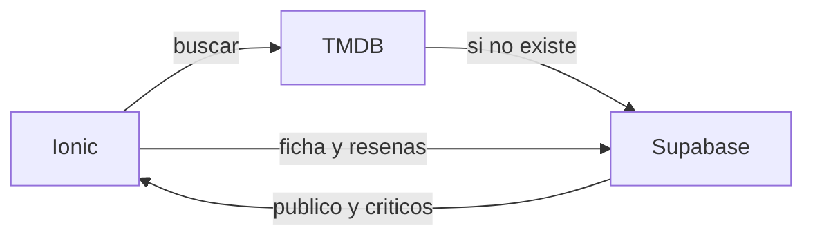

# App Rotten Tomatoes (Ionic + Angular)

App Ionic + Angular en esta carpeta, con Supabase propio, catálogo real desde TMDB y APK de depuración. El código de la app no menciona commits ni fases.

Mismas prácticas que Recetario: pnpm, `.env` fuera de git, SQL con RLS, validaciones en español, borrado de cuenta en cascada, tema claro/oscuro, y un APK instalable.

Stack: Ionic 9, Angular 22, Capacitor 8. Solo pnpm. `.npmrc` con `node-linker=hoisted` para que `cap sync` encuentre los plugins.

## Hecho

- Scaffold. Commit: `Scaffold Ionic Angular con Capacitor y pnpm`.
- Esquema Supabase (`supabase/schema.sql`), cliente y `.env` volcado al compilar. Commit: `Definir esquema Supabase de perfiles, titulos y resenas`.
- Registro, sesión, perfil con rol público/crítico, tema claro/oscuro y borrado de cuenta. Commit: `Implementar registro, sesion y perfil con rol`.
- Cartelera: buscar en TMDB y guardar el título si no está en la base. Commit: `Guardar en la base las peliculas y series traidas de TMDB`.
- Filtros de nombre, género (acción, drama, misterio), año y puntaje mínimo. Orden por puntaje del público, de críticos o por fecha.
- Ficha con carátula, sinopsis, fecha, reparto, duración, idioma y los tres puntajes.
- Reseñas: una por usuario y título, crear, editar y borrar. El rol separa el promedio del público y el de críticos.

Antes de probar: crea un proyecto Supabase nuevo, corre `supabase/schema.sql`, desactiva Confirm email, y llena `.env` con `SUPABASE_URL`, `SUPABASE_ANON_KEY` y `TMDB_API_KEY`. Luego `pnpm start`.

Angular 22 exige Node `^22.22.3 || ^24.15.0 || >=26`. El Node del sistema es 24.14.1 y no alcanza. Hay un Node 24.22.3 portable en `%LOCALAPPDATA%\node-v24.22.3-win-x64`. Hay que tenerlo al frente del `PATH` antes de `pnpm start` o `pnpm run build`.

## Datos

Proyecto Supabase nuevo. No correr este SQL en el de recetas: la tabla `profiles` chocaría.

- `profiles`: nombre, correo, rol `audience` | `critic`. Trigger al registrarse.
- `titles`: caché de TMDB (`tmdb_id` + `movie`|`tv`). Sinopsis, fecha, carátula, reparto, géneros, duración, idioma y puntaje TMDB de referencia. Promedios `audience_score` y `critic_score` los mantiene un trigger.
- `reviews`: una reseña por usuario y título (texto + puntaje 0–100). El rol del autor decide qué promedio alimenta.

RLS como en recetas: lectura para autenticados; cada quien edita o borra solo lo suyo; el trigger de puntajes es `security definer`. Borrar la cuenta limpia reseñas por `on delete cascade`.



Clave TMDB y URL/anon de Supabase solo en `.env` (hay `.env.example`). Un script las vuelca a `environment.ts` al compilar. El APK lleva esas claves horneadas. Si al implementar no existe `.env`, se pide antes de compilar.

Géneros pedidos, mapeados desde TMDB: Acción, Drama, Misterio (más los que traiga la ficha).

## Pantallas

Tabs Ionic, componentes propios, acento rojo, claro/oscuro guardado en el dispositivo.

- Login y registro (nombre, correo, clave, rol). Correo con cualquier TLD, como en recetas.
- Cartelera: buscar por nombre, filtrar género, año y puntaje mínimo, ordenar por puntaje o por fecha.
- Ficha: carátula, sinopsis, fecha, reparto, duración, idioma, puntaje TMDB, puntaje del público y puntaje de críticos, con la cantidad de reseñas. Sin reseñas se muestra "Sin puntaje".
- Reseña propia: crear, editar y borrar. Lista de reseñas en la ficha.
- Perfil: ver y editar nombre, correo y rol; cerrar sesión; borrar cuenta.

Al abrir un resultado de TMDB que no está en `titles`, se guarda y después la ficha sale de Supabase. El orden y los filtros de puntaje usan los promedios propios, no el de TMDB.

## APK

En esta máquina hay JDK 25 y no hay Android SDK. Gradle de Capacitor 8 no corre en JDK 25: hace falta JDK 21 y SDK (cmdline-tools, platform 36, build-tools). `JAVA_HOME` y `ANDROID_HOME` solo en esa sesión.

La ruta del proyecto tiene espacios. El `assembleDebug` se lanza desde una unidad `subst` corta. El APK queda en `releases/rotten-tomatoes.apk`. Es debug, instalable, no firmado para Play Store. `local.properties` no se commitea.

## Siguiente

1. APK de Android.

```bash
git commit -m "Generar APK de Android"
```

Subir, cuando exista remote:

```bash
git push -u origin HEAD
```
